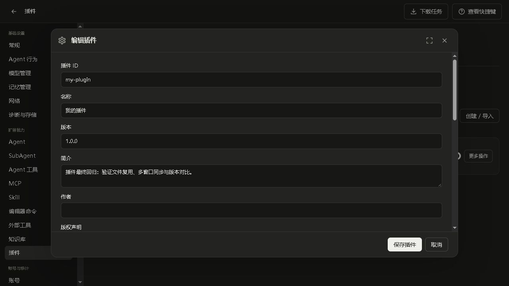
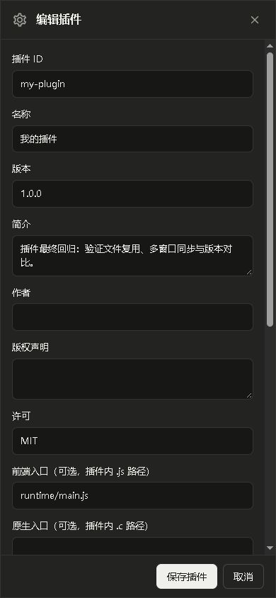

# 统一插件系统验收

客户端产品源码冻结在 `0e188a38a25f9e9d918d94a1028d97bc0f005301`，平台源码冻结在 `99f9495755d238a54efa2e2d9662f57e219e9fc3`。功能和修复分目标提交到 master。客户端版本仍为 **0.7.0 / 05000700**；最低插件能力构建号 **70000049**。平台已上线，本轮未替换官网客户端安装包或自动更新。

## 实现范围

- `mdo.plugin.v1` 统一纯文件覆盖、可选前端 JS 和原生 C 入口。不可变修订保留原文件、历史和卸载后的私有数据；例子在 `examples/plugins/frontend`、`native`、`files`。
- 精确文件映射同时绑定 `/app` 和 `/app/default-home`，文件打开、目录枚举和资源读取共享同一视图。打开的旧句柄保留旧内容，编译期间禁止中途换映射。覆盖的源码在启动候选应用前实际编译，不只挂载源码文件。
- 独占功能标记、单向冲突、依赖版本上下界、循环检测、文件占用和 SDK 注册归属共同决定兼容性。开关、组合、回滚和商店安装核对同一最终集合；确认绑定登记与文件修订，过期确认拒绝。
- 所选修订与实际执行修订分别显示。普通数据可以即时切换；专属前端入口等待所有窗口完成异步清理和确认。原生 C、资源目录、已执行 web 资源与核心源码统一要求完整进程重启。等待期间阻止 SDK 宿主重载绕过旧代码占用。
- 前端入口按插件修订隔离相对依赖，按依赖顺序启动、反序清理。失败入口不自动重复执行；确认暂时失败仅重试确认。恢复模式清理既有前端贡献，保留必要的退役确认接口。
- 核心候选编译、初始化或插件注册失败时回到基础程序恢复模式。损坏登记文件原字节保留并阻止覆盖写入；`MDO_PLUGINS_DISABLED=1` 提供外部恢复入口。受信任的原生代码仍可崩溃或产生外部副作用，本机制不提供任意 C 代码沙箱或撤销外部副作用的保证。
- 本机插件/插件商店沿用统一搜索、筛选、分页、作者版权、公共弹窗、固定底栏和全局下载任务。自定义支持创建、目录导入、文件与源码编辑、只读预览、上个修订对比、回滚、兼容关系和本机组合。并发编辑使用修订条件保存；文件仍在读取时禁止提交。
- 商店副本只能查看、启停、更新及卸载，不能编辑、导出或再次投稿。普通资源编辑器显示插件归属并阻止写入被遮盖的下层文件；停用后原文件仍在。
- 创作中心、分类商店、后台审核使用同一清单校验；支持私有稿、审核公开、版本更新、下架、历史和删除。上传的 C 源码只作静态资料展示，不在平台执行。原有账号配额与每版本审核材料计费口径沿用。
- 界面不再有独立扩展包分类。历史 modules/组合包的原文件、运行入口、收据和审核记录保留，不自动重写历史作品或执行新代码。

## 验证

| 验证 | 结果 |
| --- | --- |
| 原生扩展包格式校验 | 74 项通过 |
| `test_plugins_runtime.py --host .build/host/xs.exe` | 通过 |
| `test_plugins_runtime.py --packed …/windows/mdo.exe` | 最终 Windows 成品通过 |
| Linux 最终 ELF：同一插件套件 + Application SDK CRUD/注册回归 | 通过 |
| Windows 两个隔离宿主：本机创作 → 投稿 → 审核 → 分类列表 → 信任确认 → 安装 → 启用 → 更新 → 卸载 | 通过，含跨窗口 plugin.changed 通知断言 |
| 最终 Windows 成品扩展回归 | 22 次本地模拟模型请求，最终错误 0；覆盖 C 工具、Skill、委派、角色、MCP 与构建器 |
| plugin-loader、Application SDK UI、商店、格式和语言包 Node 回归 | 23 项通过 |
| Application SDK 契约、前端契约、模块解析/可达性 | 分别 6 项、20 项、233 模块通过 |
| 平台现有 Linux 运行时隔离预检 | 插件及既有 Skill、Agent 工具、命令、MCP、知识库、Agent/SubAgent、外部工具和迁移通过 |
| 实际浏览器 | 创建、保存、启用、文件复用、更新后自动状态同步、修订对比通过；桌面与 390×844 布局通过 |
| Android APK | 轻量版/完整版编译通过；安装器策略 19 项与固定运行时集成通过；v2/v3 签名与 16 KiB 对齐通过 |

插件运行时测试额外覆盖：2 MiB 上传、深层/隐藏目录、摘要错误与路径穿越拒绝、已安装文件复用、损坏清单不覆盖、旧注册不重复执行、C 语法/注册冲突恢复、实际核心 C 行为覆盖、普通 Skill 实际调用覆盖、过期编辑保存拒绝、预设修订固定和原文件保存。测试全部使用独立目录与本地模拟，不调用真实模型供应商。

浏览器截图：

手机宽度下文档宽度为 390，没有横向溢出；底栏高 59，scrollHeight 同为 59，内容独立滚动。ADB 当前无设备，**本轮未完成 Android 真机加载/WebView 回归**。Linux 产物为本机 glibc 验证版，要求 glibc 2.38，**不是经 glibc 2.28 基线认证的正式发行包**。

## 部署与产物

线上仅条件替换本次相关的 11 个源文件/页面文件，并短暂重启 `xs.service`。部署前核对线上文件属于已知提交，保留私有备份与只读目录数据库快照；未覆盖并行任务的模型网关改动，未恢复旧数据库覆盖新增数据。最终核对服务 active、文件摘要一致、程序与 xs.json 摘要未变，HTTPS 创作中心脚本、插件预览及插件分类接口均为 200。公开插件列表目前为空，测试稿仅存在隔离测试站点。

产物位于 `.build/plugins-ecosystem-20261026/`：Windows `windows/mdo.exe`（构建 70000049），Linux `linux/linux-x86_64-glibc-server/mdo-server`（70000052），Android 轻量版 `mdo-arm64-v8a.apk`（70000055）和完整版 `mdo-full-arm64-v8a.apk`（70000056）。全部摘要、签名及平台回执见同名 JSON。

私人部署证据保存在本机 `.build/plugins-ecosystem-20261026/` 和服务端 `/home/xs/mdo-plugins-ecosystem-20261026`。早期隔离测试遗留的 8 条 Offline fixture 插件登记已在持有 Home 锁并备份后精确移除，其他记录与不可变修订保留。临时浏览器页面与 QA 服务已停止，私有证据保留。用户原有 `app/xs.json` 和 `tests/test_remote_asymmetric_pause.py` 摘要未变。
