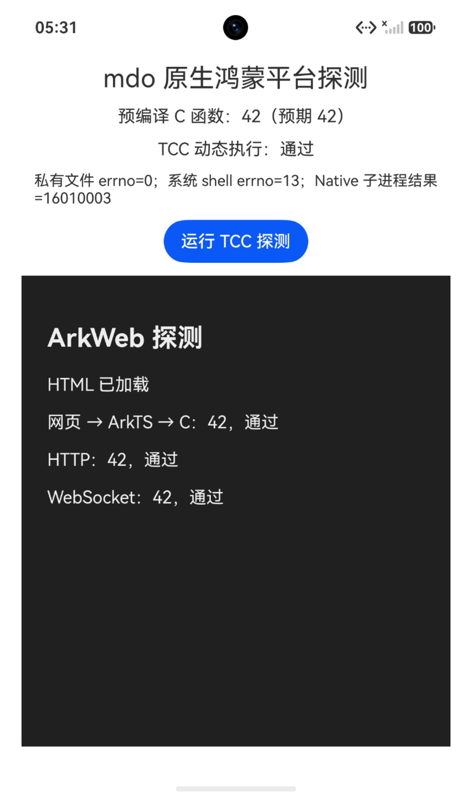

# mdo 原生鸿蒙模拟器验证与投入评估

验证日期：2026-10-09。范围：本机模拟器可行性实验，尚未实现正式 mdo
鸿蒙版本，也未修改正式 xs/xrt 的平台代码。

## 结论

可以继续投入对话和远程控制方向：官方模拟器内已通过 ArkWeb、网页与 C
桥接、localhost HTTP/WebSocket、私有文件读写和 TCC 最小调用。现有 C
核心和 HTML 前端具有复用基础，不需要重写整套界面。

完整本地编码 Agent 仍有两个决策门槛：**正式签名 ARM64 手机的动态 C
执行能力**和**本地命令执行能力**。系统 shell 启动实测遭权限拒绝；官方
Native 子进程 API 也未在本次应用中启动成功。不能把 Android 命令工具包
原样带过去并承诺全部功能可用。

建议先完成真机门槛验证，再决定正式适配范围。当前结果足以支持继续
做小规模原型，不足以承诺完整本地开发环境。

## 实测结果

全部运行检查均发生在安装后的探测 HAP 内，应用 UID 为 `20020063`，
安全域为 `o:r:debug_hap:s0:x95,x334,x512,x868,x1024`。
应用仅声明 INTERNET 权限；没有提权、修改 SELinux、安全策略或签名检查。

| 检查 | 结果 | 能证明什么 |
| --- | --- | --- |
| 官方手机模拟器启动、HAP 安装和启动 | 通过 | 本机可进行应用内开发验证 |
| 预编译 C → Node-API → ArkTS | 返回 42 | 原生 C 接入基础可用 |
| ArkWeb 加载 HTML、网页 → ArkTS → C | 返回 42 | 复用 HTML 前端的桥接基础可用 |
| 网页 fetch → 回环地址原生 HTTP 服务 | 返回 42 | 本机前后端通信基础可用 |
| 网页 WebSocket → 回环地址原生服务 | 返回 42 | WebSocket 基础可用，握手使用原有 xrt 实现 |
| pthread 服务线程 | 通过 | 最小网络服务可在原生线程运行 |
| 应用私有目录文件写入、读取、删除 | errno=0 | 私有 Home 的文件操作基础可用 |
| TCC 编译、重定位、符号解析、动态函数调用原生回调 | 通过，结果 42 | 本模拟器调试应用内最小动态 C 链路可用 |
| 应用 posix_spawn `/system/bin/sh -c 'exit 0'` | EACCES=13 | 此系统 shell 路径未获准执行 |
| 官方 `OH_Ability_IsNativeChildProcessSupported` | false | 本次应用/环境的能力检查未通过 |
| 官方 `OH_Ability_StartNativeChildProcess` | 16010003，pid=-1 | SDK 定义为 SERVICE_ERROR，未执行子进程入口 |
| ARM64/x86_64 原生探测库和 TCC 编译链接 | 通过 | 两种 ABI 的编译链路可用；ARM64 未运行 |
| 当前 compact mdo 的 xrt 模块闭包编译链接 | 两种 ABI 均通过 | 声明、平台分支及链接可编译，不等于模块运行验收 |

系统 shell 和 toybox 均存在且为 0755；因此本次 EACCES 不是“文件不存在”
或简单的缺少可执行位。没有获得可精确归因到该进程的安全审计日志，
不把具体拒绝原因写成已证实结论，也不据此断言整个鸿蒙不支持子进程。

官方 Native 子进程 API 加载已打包共享库及指定入口，与启动任意 shell
可执行文件不同。本次 HAP 包含 `libmdochildprobe.so` 两种 ABI；能力检查
为 false，启动返回服务错误，尚不能确定换真机、签名或配置后的行为。
手机、平板、PC 的结论需要分别验证，不能混用。

详细运行记录：[验收记录](../tests/harmony/evidence/2026-10-09-results.txt)。

## 工具链与环境

| 项目 | 实际使用 |
| --- | --- |
| Windows | Windows 10 Pro，build 19045 |
| CPU / RAM | Ryzen 5 5600 / 约 32 GB |
| GPU / 实际 OpenGL | Radeon RX 5700 / 4.6 |
| 虚拟化 | Windows Hypervisor Platform 实际运行成功 |
| DevEco Studio | 26.0.0.851 |
| Native SDK | 26.0.0.105，API/platformVersion 26.0.0 |
| Native Clang / Hvigor | 15.0.4 / 6.26.8 |
| Emulator | 26.0.0.402 |
| 镜像目录元数据 | 官方 HarmonyOS 7.0.0(26.0.0)，softwareVersion 7.0.0.107 |
| 客体系统自报 | OpenHarmony-7.0.0.105，x86_64 |
| 实例 | mdoProbe7lite，手机类型，2 GB 内存、6 GB 数据分区 |

镜像来自华为官方 DevEco 手机镜像目录。保留目录名称及客体自报版本的
差异，不将其描述成商用签名 ARM64 手机的等价替代。

官方安装包的 Authenticode 验证为 Valid，签名者为 Huawei Technologies
Co., Ltd. 下载 ZIP 的本地 SHA-256 为
`33ce2d302ecccdbc27287bd6523bd32c6f4da32c80d6c7f33057b83b1eefb9d9`。
没有取得可比较的官网 SHA 文本，因此不宣称完成“官网 SHA 比对”。

最终 HAP/两种 ABI/xrt 编译使用的 xs 为
`f47b0de5037f458f6289483d1323dee417d99434`，对应验证时的 `deps.lock`。
xrt 锁定为 `6040abda647bd947bd561cd185f37a3751f122f4`。
早期探测曾使用 xs `9a0f5f6fa7b4aec52945985d607b5f09237b1035`；后续锁定
版本更新后重新构建并运行最终 HAP，同时重跑 Windows 对照及两种 ABI
编译。HAP CMake 会刷新源码路径，避免旧缓存继续引用旧版本。

主要文件位置：

- 工具链：`D:\runtimes\harmony\DevEcoStudio`。
- 下载：`D:\runtimes\harmony\downloads`。
- SDK 构建缓存与临时目录：`D:\runtimes\harmony\cache`、`temp`。
- 官方镜像及实例：`D:\runtimes\harmony\emulator\images`、`instances`。
- 仓库构建证据：`.build/harmony-assessment`；HAP 位于
  `tests/harmony/hap/entry/build/default/outputs/default/entry-default-unsigned.hap`。

大文件放 D 盘；官方工具仍创建了少量用户配置/日志目录，不声称 C 盘零写入。

第一次 4 GB 实例和同时构建遇到主机提交内存不足。Windows 提交上限约
36 GB，已有程序占用较高，即使物理内存尚有余量也会失败。改用 2 GB
实例，并采用“停模拟器 → 编译 → 启动验收”后完成本轮功能测试。未修改
页面文件、驱动或虚拟化配置。这属于本机资源约束，不是 xs/TCC 兼容性
失败，也不是压力测试。

## 正式适配方案与工作量

以下为一名熟悉 xs/mdo 和原生鸿蒙开发的工程师的粗略工作日估算；阶段
相互衔接，重叠工作不重复相加。证书、设备、发布审核等待不计入。

| 阶段 | 工作 | 粗估 |
| --- | --- | --- |
| 决策门槛 | ARM64 真机、正式签名方式下重跑 TCC/回调和两种进程探测，查明可用范围 | 1–3 日，前提是设备及签名材料齐备 |
| 可用对话/远程控制原型 | ArkTS UIAbility + ArkWeb 壳；C 后端接入；私有 Home、联网/TLS、账户、输入/键盘、返回导航和前后台恢复；HAP 构建 | 10–15 日，前提是后端启动方式可用 |
| 可交付基础本地 Agent | 上述内容加私有文件工具、文件选择/导入导出、可用的生态能力、恢复行为、多语言、移动端验收和安装说明 | 合计约 15–25 日，动态 C 和后端门槛通过时 |
| 完整命令工具包和 stdio MCP | 命令执行、进程 I/O、取消、子 Agent、第三方 CLI 适配 | 暂不承诺工期；先解决平台执行门槛 |

正式实现应保持小而清晰：新增一个鸿蒙平台壳和少量平台接口，继续复用
现有 HTML 前端、C Agent、会话/配置格式。平台差异主要集中在生命周期、
私有目录、文件选择、外部链接、设备能力及进程适配，不扩建另一套业务层。

需要优先处理的具体改动：

1. **xs 宿主**：接入 OHOS 工具链和应用内 C 入口；借鉴 Android 嵌入式宿主
   的启动/停止边界，替换 JNI 和 Android 平台桥接。
2. **TCC/VFS**：准备鸿蒙目标的 SDK 头文件/CRT、宿主导出与资源映射，
   验证完整后端编译及运行。本次无头文件小函数通过，没有覆盖双 VFS、
   完整模块导入或 mdo unity 后端。
3. **Web 平台壳**：ArkWeb 与现有网页连接；文件/附件、剪贴板、打开链接、
   输入法与前后台恢复由薄桥接层处理，不移植 Android API 名称。
4. **文件与权限**：Home 放应用私有目录；访问用户文档走系统选择/授权机制。
   不能假定私有目录读写成功就能访问整台手机文件系统。
5. **工具能力**：原生文件工具和远程任务优先；shell、动态 C 扩展、stdio MCP
   按实测能力开放。未通过的能力应明确禁用并说明，而不是运行时反复报错。
6. **分发与更新**：新增 HAP 产品标识、签名/安装流程、官网说明和更新配置；
   安装更新遵循系统机制，不能照搬 Windows/Linux 的可执行文件自替换。

当前 xs 在 `src/script/script.h` 使用 `tcc_add_file` / `tcc_relocate`
加载服务；mdo 的正式后端启动本身依赖 TCC。因此若正式手机不能使用该
链路，影响的不仅是自定义 C 工具：还需另行设计并评估 **预编译/AOT 后端**
与相应模块注册。该分支不包含在以上动态 C 通过前提下的估算里。

## 尚未验证与下一次验收

- ARM64 真机上的调试/正式签名执行，应用市场发布规则与所需权限。
- 完整 xs/TCC 双 VFS、mdo 后端启动、模型对话和登录回调。
- 原生 TLS/证书库、在线账户和真实远程设备通信。
- 文件选择/授权目录、附件、剪贴板、外链、通知和后台生命周期。
- 页面长列表、流式回复、输入法和真实用户交互；本轮只做小规模功能探测。
- 各种命令执行路径、完整子 Agent/命令工具包、stdio MCP。
- 较早 HarmonyOS 版本的兼容性；本次 HAP 的 target/compatible SDK 均为 26.0.0。

下一次优先在可用于签名调试的 ARM64 手机上重跑本目录探测。若 TCC
通过而进程仍不可用，可先做对话、私有文件和远程控制版本；若 TCC 不通过，
先评估 AOT 后端，再决定投入。没有为了通过实验关闭安全机制。

## 复现与依据

构建、安装、运行步骤见 [探测 README](../tests/harmony/README.md)。
官方 SDK 的 `AbilityKit/native_child_process.h` 定义了本次所用 API、
共享库入口方式和 `NCP_ERR_SERVICE_ERROR=16010003`，以实装版本为准。

官方资料用于工具链/模拟器背景，运行结论以本次 HAP 验收记录为准：

- [官方 DevEco 下载](https://developer.huawei.com/consumer/cn/download/deveco-studio)。
- [官方模拟器硬件要求](https://developer.huawei.com/consumer/cn/doc/doccenter-deveco-studio/ide-emulator-requirements)。
- [官方安装说明](https://developer.huawei.com/consumer/en/doc/harmonyos-guides/ide-software-install)。
- [官方命令行模拟器说明](https://developer.huawei.com/consumer/cn/doc/doccenter-deveco-studio/ide-commandline-emulator)。

本轮验证结束后已停止探测模拟器以释放内存；工具链、镜像、实例和构建
产物仍留在 D 盘，可用于后续复测。
