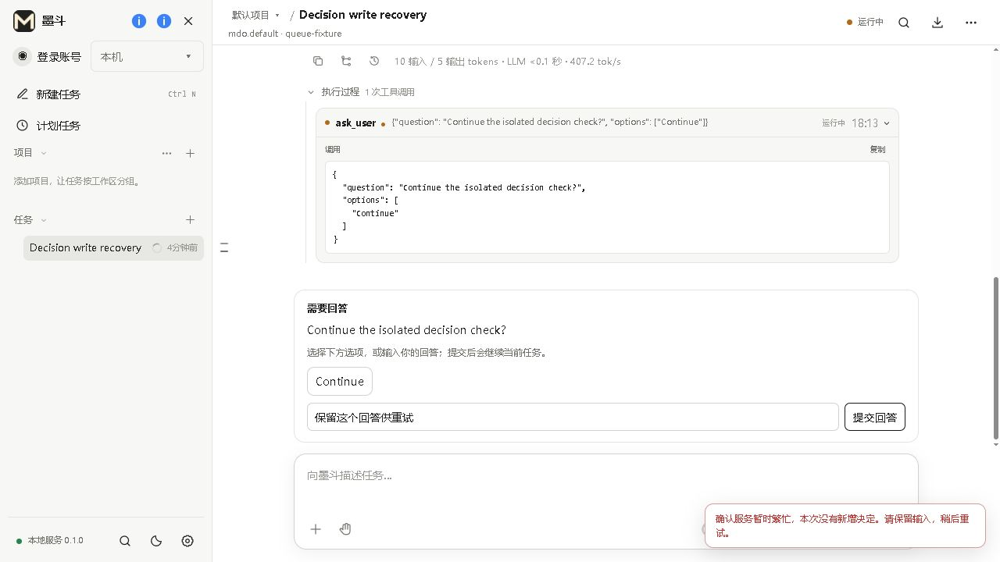
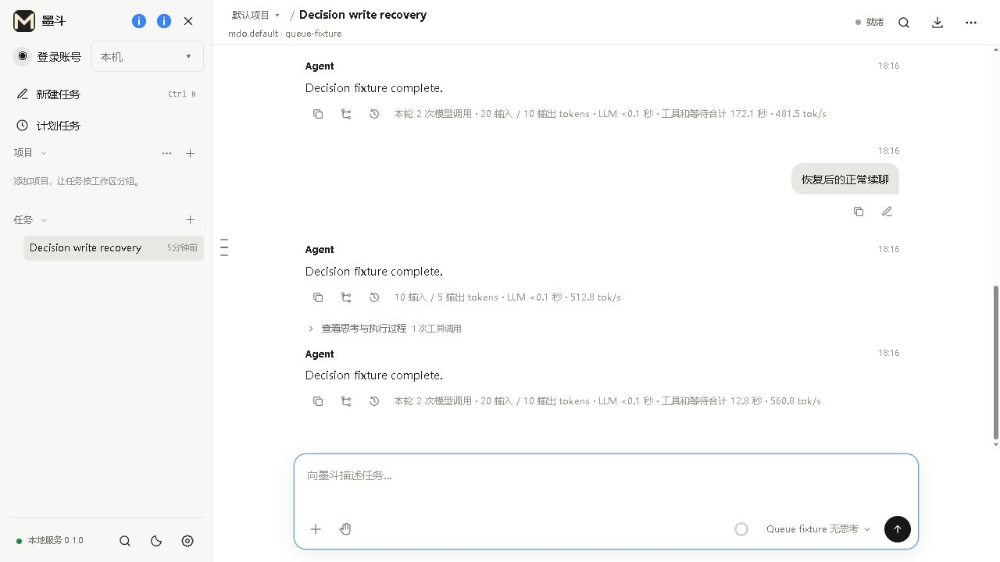

# 回答和审批确认恢复（2026-10-09）

修复提交为 `b0a7722fb84175971a4929f7fea2cb4c1767d553`，xs 锁定
`f47b0de5037f458f6289483d1323dee417d99434`。Windows 独立候选：

```text
.build/conversation-acceptance/decision-write/mdo-clean.exe
```

这是从干净产品源码构建的候选，没有覆盖日用程序、手机或官网。候选没有
故障接口或身份绕过；本次只使用普通可编辑的回环模型、独立 Home 和本地代理。
`candidate.json` 记录实际 EXE 哈希、构建回执和 15 个包内生产文件的逐字节核对。

## 原生执行与边界

`baseline.json` 来自 `a05ecc2f` 的真实 xs/TCC 源码：同一回答由两个客户端提交，
返回 200/404，基线在预期检查中失败。修复后 `native.json` 确认：

- 相同回答和审批能在问题/工具结束后取回确认，不同内容返回明确冲突。
- 任务执行器结束并清理关联后，相同任务回答仍可取回确认。
- 两个相同提交都得到成功确认；实际命令只执行一次，两个工具成功，零最终错误。
- 已取消的问题返回 404，不能把“列表里消失”当作提交成功。
- 主机重启拒绝旧写入令牌；新令牌也不能使用已清除的旧确认。
- 151 项直接内存检查覆盖失败不留确认、120 秒期限、重复读取不续期、写入代
  隔离、固定 128 项容量、无活跃项驱逐、无效输入及销毁复位。它没有生成
  128 次 HTTP/工具请求，不属于压力或高负载测试。

28 项相关 Node 检查、三语提示、154 个模块图、16 项构建契约及严格 GCC
检查通过。打包默认 Agent/工具清单也通过。

## 实际打包页面

`browser.json` 来自未修改的候选经真实 HTTP 代理运行。代理在原生服务完成操作
之后丢弃第一个回答确认，并把第一个审批的 200 响应正文延迟 12 秒。实际页面
恢复行为如下：

- 回答约 0.56 秒后自动取回相同确认；审批约 8.59 秒后自动取回相同确认。
  页面没有中途报错，两个按钮保持提交锁；等待时输入的中文草稿完整保留。
- 第二个问题在服务器应用之前连续收到 503；每次显式提交最多六次、指数退避。
  为捕获短时提示，独立手动复测了三轮；前两轮没有及时截到提示，第三轮捕获
  **一条**“确认服务暂时繁忙，本次没有新增决定。请保留输入，稍后重试。”
  输入“保留这个回答供重试”仍在，并恢复编辑与提交。
- 恢复代理后直接重试同一回答，当前任务结束；正常续聊及其询问也成功完成。
- 共三轮对话、七次模型请求、四个成功工具、一个实际命令、零最终模型错误。
  最后页面没有待答问题、待批请求或错误通知。所有测试服务及页面已经关闭。





复测入口（浏览器操作使用 CUA 或手动操作）：

```powershell
python tests/test_decision_retry_runtime.py --host <locked-xs.exe> --evidence <native.json>
python tests/test_decision_retry_runtime.py --host <locked-xs.exe> --baseline-commit a05ecc2f --evidence <baseline.json>
python tests/manual_decision_write_recovery_qa.py --packed <mdo-clean.exe> --directory <新的隔离目录>
python tests/acceptance/decision-write-recovery/check_candidate.py --exe <mdo-clean.exe> --report <candidate.json>
```

基线命令应失败在 200/404 检查。页面夹具打印 URL 和 stop/block/resume 文件；
发送 `interactive-decision`，回答 Continue 并允许此次隔离命令。等待期间输入
草稿，核对无错误和内容保留。创建 block 文件，再发送 `blocked-decision` 并
填写回答，等六次退避后的最终提示；创建 resume 文件后重试，再正常续聊。
创建 stop 文件收集证据并关闭服务；整个夹具最长六分钟。

本阶段 adb 没有连接设备，未实测 Android WebView/输入法/系统文件选择器。
外部模型和线上服务没有注入故障；不能据此声称所有功能已经通过验收。
